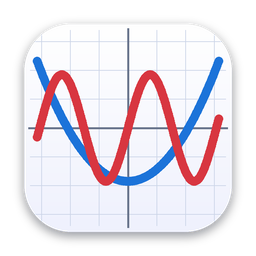

<p align="center">
  
</p>

<h1 align="center">Grapher NG</h1>

<p align="center">
  A native macOS graphing app: type a formula, get curves, regions and surfaces.<br>
  <b>English</b> · <a href="README.zh-CN.md">简体中文</a>
</p>


**2D graphs** cover every planar plot kind (explicit functions, parametric curves, polar curves, implicit curves and
inequality regions); **3D graphs** have explicit surfaces, parametric surfaces, space curves and implicit surfaces, and
2D curves can be placed in 3D as well. The interface is in English and Chinese and follows the system language.
Built with Swift, AppKit and Metal; the only third-party package is Sparkle, for automatic updates.

## Download

Download `GrapherNG-<version>.dmg` from [GitHub Releases](https://github.com/xVanTuring/grapher-ng/releases), open it and
drag Grapher NG into Applications. The app is signed with a Developer ID and notarized by Apple, and requires macOS 14 or later.
Once installed it checks for updates once a day; you can also check manually with Grapher NG ▸ Check for Updates….

## Five plot kinds

| Kind | How to write it | Example |
|---|---|---|
| Explicit function | `y = f(x)`, enter just `f(x)` | `a*sin(x)/x` |
| Parametric curve | two fields, `x(t) =` and `y(t) =` | `16*sin(t)^3` and `13*cos(t)-5*cos(2*t)-2*cos(3*t)-cos(4*t)` |
| Polar curve | `r(θ) =`, with the variable written `theta` or `t` | `1 + cos(theta)` |
| Implicit curve | `F(x, y) = 0`, enter just `F` | `x^3 + y^3 - 3*x*y` |
| Inequality region | `F(x, y) ≤ 0` and so on, enter `F` and pick the relation | `x^2 + y^2 - 1` with `≤` |

## Formula syntax

- **Variables**: explicit functions use `x`; parametric and polar curves use `t` (polar also accepts `theta`); implicit curves and regions use `x` and `y`.
- **Constants**: `pi`, `π`, `e`, `tau`, `τ`.
- **Operators**: `+ - * / % ^`, comparisons `< <= > >= == !=`, logic `&& || !`, ternary `? :`.
  `^` is right-associative and binds tighter than unary minus: `-x^2` is `-(x^2)`, and `2^-3` is 0.125.
  Comparisons and logic evaluate to 0 or 1, so they can be used as numbers.
- **Implicit multiplication**: `2x`, `3sin(x)`, `2(x+1)`, `2x^2`, `xy` and `2xy` all work.
  `1/2x` means `(1/2)*x`.
- **Functions**:
  `sin cos tan cot sec csc asin acos atan atan2 sinh cosh tanh asinh acosh atanh
  exp ln log log2 log10 sqrt cbrt abs sign floor ceil round trunc erf gamma
  mod pow hypot min max clamp step smoothstep if`
  (`log` is the natural logarithm; `if(condition, then, else)` writes piecewise functions.)

A few things to watch out for:

- A name followed directly by `(` is always a function call, so `x(x+1)` reports `Unknown function "x"`; write `x*(x+1)`.
- A multi-letter identifier is first looked up as a whole, then split into single-letter variables multiplied together:
  `xy` is `x*y`, while `sinx` is an error. Constants are not split out, so write `x*e` rather than `xe`.
- NaN anywhere counts as false, and `&&` / `||` really short-circuit, so `x>0 && log(x)>1` safely gives 0 at `x=-1`.
- When a formula has an error, the field shows the column and a `^` marker underneath, and the graph keeps its last valid result.

## Parameter sliders

Add a parameter (say `a`) under Parameters in the sidebar and use it in any formula as a constant. Dragging its slider
redraws the graph live, which is the easiest way to see how a parameter shapes a curve.

## 3D graphs

File ▸ New 3D Graph (⇧⌘N) opens an empty 3D window; File ▸ Load Example loads a surface, a torus, a helix and a sphere.
Everything is drawn inside a box and clipped to it. There are two kinds of zoom: zooming the graph changes the range the
box covers (the box stays the same size on screen), while enlarging the box makes the box and the graph bigger on screen.

| Kind | How to write it | Example |
|---|---|---|
| Explicit surface | `z = f(x, y)`, enter just `f` | `a*sin(x)*cos(y)`, drawn over the box's x and y range |
| Parametric surface | three fields `x(u,v)`, `y(u,v)`, `z(u,v)`, plus ranges for u and v | a torus, `(2.4+0.7cos(v))cos(u)` … |
| Space curve | three fields `x(t)`, `y(t)`, `z(t)`, plus a range for t | a helix, `3.3cos(t)`, `3.3sin(t)`, `t/4` |
| Implicit surface | `F(x, y, z) = 0`, enter just `F` | a sphere, `x^2 + y^2 + z^2 - 4` |

The four 2D curve kinds (explicit, parametric, polar, implicit) can be added to a 3D graph too. By default they are drawn on
the z = 0 plane; turn on Extend into 3D and they are swept along z into a vertical surface through the box, so `y = x`
becomes a slanted wall and `x^2 + y^2 - 4` a cylinder.

| Action | Shortcut |
|---|---|
| Rotate | Drag / arrow keys (10° per press) |
| Pan | `⇧`-drag / two-finger scroll |
| Zoom the graph (change the range) | `⌘`-scroll or pinch; `=` / `-` |
| Enlarge the box | `⌥`-scroll or `⌥`-pinch; `⌥=` / `⌥-` |
| Fit content / default view | `F` / `R` |

3D graphs export as PNG (re-sampled at the target resolution, with tick labels drawn in); vector PDF and sample-point CSV
are available for 2D graphs only.

## 2D controls

| Action | Shortcut |
|---|---|
| Pan | Drag / two-finger scroll |
| Zoom | `⌘`-scroll or pinch (anchored at the pointer) |
| Read values | Move the pointer to see the nearest point on a curve, its coordinates and slope |
| Fit content | `F` |
| Reset view (back to the origin) | `R` |
| Zoom in / out | `⌘=` / `⌘-` |
| Undo / redo | `⌘Z` / `⇧⌘Z` |

The canvas is "infinite": you can keep panning and zooming, but there is a **soft boundary**. The visible area must
intersect the bounding box of all curves grown by 1.5 viewports, and it is pulled back if it strays further. A truly
infinite canvas lets you scroll off into empty space and never find your way back.

## Files and export

- **Documents**: `⌘S` saves a `.grapher` file (its content is JSON); double-click it in Finder or use `⌘O` to open it.
  Grapher NG uses the standard macOS document model: one window per document, "Edited" appears under the title when there
  are unsaved changes, and closing or quitting asks whether to save. Older `.json` files still open and are saved as `.grapher`.
- **Finder**: the file icon is a thumbnail of the graph. Press Space for a Quick Look preview that you can pan and zoom
  (and rotate, for 3D) with the same gestures as the app; double-click returns to the saved view.
- **Welcome window**: shown at launch (⇧⌘1 at any time). On the left, start a 2D or 3D graph, open a file or open an example;
  on the right, recent documents with thumbnails, a click away. Untick "Show this window when Grapher NG starts" to start
  with a blank 2D graph instead. Right-click the Dock icon to create or open documents as well.
- **PNG**: 1× / 2× / 4×. The graph is **re-sampled** at the target resolution rather than scaled up from the screen, so a
  4× image really has four times the detail in its curves.
- **PDF**: true vectors, sharp at any magnification.
- **CSV**: the sample points of every visible curve in three columns, `layer,x,y`, ready to feed into another script.

## How the rendering stays smooth

"Curves must be smooth" is a hard requirement of this project, and it is not met by turning up MSAA:

- **Lines** are expanded per segment into screen-space quads, and the fragment shader computes the exact distance from the
  pixel centre to the segment and turns it into coverage. Edges get an exact one-pixel grey ramp, line width stays constant
  at any zoom, and ends and joins are round.
- **Filled regions** compute sub-pixel coverage along their boundaries pixel by pixel (8×8 sub-sampling of the grid's
  bilinear interpolation), at the same quality as the strokes.
- **Curve sampling** subdivides adaptively by curvature: a segment is split whenever its chord error exceeds 0.14 pixels,
  and parametric curves also check the turning angle.
- Implicit curves are traced with marching squares, and the scattered cell segments are stitched into continuous polylines
  instead of drawing one curve as a pile of short segments.
- Sampling runs on the CPU in `Double` (Apple GPUs have no double precision). While dragging it drops to about 1/3
  resolution and re-samples at full quality 200 ms after you stop.

The evidence lives in the tests: `Renderer2DTests` asserts exported pixel values directly (coverage along a 45° edge, line
width stability under zoom, channel order, layer order, round caps), and `SamplingTests` asserts that a filled region's ink
equals πr², that 1/x never draws a vertical connector, and so on.

3D surface edges rely on 4× MSAA (triangle edges cannot have analytic coverage), while space curves and the box lines still
get per-pixel distance coverage; everything outside the box is clipped exactly on the GPU by six clip planes.
`Sampling3DTests` asserts that an implicit sphere's vertices lie on the sphere and its area equals 4πr²; `Renderer3DTests`
asserts that not a single pixel is drawn outside the box and that nearer faces hide farther ones.

## Development

```bash
xcodegen generate                          # the project is generated from project.yml; GrapherNG.xcodeproj is not checked in
xcodebuild -project GrapherNG.xcodeproj -scheme GrapherNG \
  -derivedDataPath build/DerivedData -resolvePackageDependencies   # resolve Sparkle before the first build
bash scripts/build.sh                      # same as xcodebuild … -derivedDataPath build/DerivedData build
open build/DerivedData/Build/Products/Debug/GrapherNG.app

bash scripts/run.sh                        # build and run, with logs in the terminal
bash scripts/test.sh                       # run the unit tests
```

Requires Xcode and `xcodegen` (`brew install xcodegen`). The project is managed the same way as Perch, FreeMind and UniReader.
Signing, notarization, packaging and releases are described in [docs/release.md](docs/release.md) (in Chinese).

The icon can be regenerated with `bash scripts/make-icon.sh` (needs Python with Pillow); it writes
`Sources/GrapherApp/Resources/Assets.xcassets/AppIcon.appiconset`.

### Headless mode

Handy for debugging and making images:

```bash
# Render an image without opening a window
build/DerivedData/Build/Products/Debug/GrapherNG.app/Contents/MacOS/GrapherNG \
  --render out.png --doc doc.grapher --width 1600 --height 1200 --quality high

# Render the 3D example (pass a 3D file with --doc), from another angle
build/DerivedData/Build/Products/Debug/GrapherNG.app/Contents/MacOS/GrapherNG \
  --render out.png --space --azimuth 1.2 --elevation 0.3

# Sampling and evaluation performance
build/DerivedData/Build/Products/Debug/GrapherNG.app/Contents/MacOS/GrapherNG --benchmark
```

### Code layout

```
project.yml          xcodegen project definition (GrapherNG.xcodeproj is generated)
Sources/
  GrapherKit/        pure logic with no UI framework (framework target)
    Expr/            lexer → parser → bytecode → stack VM evaluator
    Sampling/        adaptive subdivision, marching squares, region fill, probes, scene assembly, axis label layout;
                     3D surface meshes, marching tetrahedra, space curves, box wireframe
    Model/           documents, layers, view transforms (2D viewport, 3D box and camera), ticks, canvas input rules
    IO/              PDF / CSV export
  GrapherRender/     Metal rendering (framework target): 2D strokes and fills, 3D surfaces and lines,
                     offscreen export, thumbnails, MTKView wrappers
  GrapherApp/        AppKit UI and event handling, document model, welcome window, updates, command-line mode
Extensions/
  QuickLook/         Finder Quick Look preview (an interactive, read-only canvas)
  Thumbnail/         Finder file thumbnails
Tests/
  GrapherNGTests/    expressions (with fuzzing and benchmarks), sampling and geometry, the full pipeline,
                     pixel assertions on offscreen renders
```

The code is split into three targets rather than one app so that the compiler enforces a boundary: **GrapherKit may not
import AppKit**. Most of the unit tests run against it.

In Debug, `GrapherKit` alone is built with `-O` and whole-module optimization: this layer is numerically heavy, and `-Onone`
makes grid evaluation 27 times slower (1.2M vs 32M points per second measured), leaving 5 frames per second while dragging.
The UI layer stays at `-Onone` for normal debugging.

The UI is all AppKit: a three-pane `NSSplitViewController`, an `NSTableView` layer list, `NSStackView` forms, `NSColorWell`
colour pickers, an `NSToolbar` and a hand-built `NSMenu` menu bar. Tick labels and the pointer read-out sit in a layer above
the Metal canvas, drawn with Core Graphics and Core Text. `AppState` broadcasts changes through a minimal observer callback
with no Combine or binding framework; no declarative UI framework is involved anywhere.

## Not done yet

- **Surface–surface intersection curves** (dimension reduction for `z=f ∩ z=g`, grid slicing with Newton refinement for
  implicit ∩ implicit, intersection in the uv plane for parametric ∩ implicit).
- 3D: translucent surfaces, hover read-out, vector export.
- Tangent and normal lines, free text annotations.
- Data scatter plots and statistical charts.
