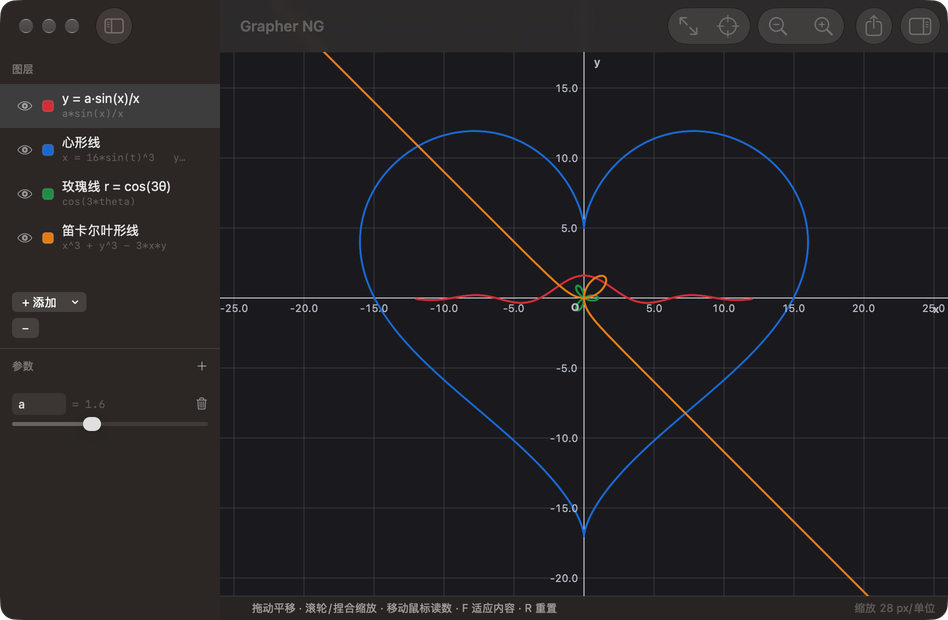

# Grapher NG

macOS 上用来画数学图形的工具：输入公式，画出曲线、区域和曲面。原生 Swift + Metal，没有任何第三方依赖。

**平面图**覆盖 2D 的全部图型（显函数、参数方程、极坐标、隐函数、不等式区域）；**立体图**有显式曲面、参数曲面、
空间曲线、隐式曲面，平面曲线也能放进立体图。两曲面交线是下一期。界面中英双语，跟随系统语言。



## 快速开始

```bash
xcodegen generate                          # 工程由 project.yml 生成，GrapherNG.xcodeproj 是生成物、不入库
bash scripts/build.sh                      # 等价于 xcodebuild … -derivedDataPath build/DerivedData build
open build/DerivedData/Build/Products/Debug/GrapherNG.app

bash scripts/run.sh                        # 构建并直接跑，日志输出到终端
bash scripts/test.sh                       # 跑单元测试
```

需要 Xcode 和 `xcodegen`（`brew install xcodegen`）。工程管理方式与 Perch / FreeMind / UniReader 一致。

图标可以重新生成：`bash scripts/make-icon.sh`（需要带 Pillow 的 Python），产物是 `Sources/GrapherApp/Resources/Assets.xcassets/AppIcon.appiconset`。

## 五种图型

| 类型 | 公式写法 | 说明 |
|---|---|---|
| 显函数 | `y = f(x)`，只填 `f(x)` | 例如 `a*sin(x)/x` |
| 参数方程 | `x(t) =` 与 `y(t) =` 两栏 | 例如 `16*sin(t)^3` 与 `13*cos(t)-5*cos(2*t)-2*cos(3*t)-cos(4*t)` |
| 极坐标 | `r(θ) =`，变量写 `theta` 或 `t` | 例如 `1 + cos(theta)` |
| 隐函数 | `F(x, y) = 0`，只填 `F` | 例如 `x^3 + y^3 - 3*x*y` |
| 不等式区域 | `F(x, y) ≤ 0` 等，只填 `F`，再选关系 | 例如 `x^2 + y^2 - 1` 配 `≤` |

## 公式语法

- **变量**：显函数用 `x`；参数方程与极坐标用 `t`（极坐标也可写 `theta`）；隐函数与区域用 `x`、`y`。
- **常量**：`pi`、`π`、`e`、`tau`、`τ`。
- **运算符**：`+ - * / % ^`，比较 `< <= > >= == !=`，逻辑 `&& || !`，三元 `? :`。
  `^` 右结合且优先于负号：`-x^2` 是 `-(x^2)`，`2^-3` 是 0.125。
  比较和逻辑的结果是 0 或 1，可以当数值继续参与运算。
- **隐式乘法**：`2x`、`3sin(x)`、`2(x+1)`、`2x^2`、`xy`、`2xy` 都能用。
  `1/2x` 按 `(1/2)*x` 理解。
- **函数**：
  `sin cos tan cot sec csc asin acos atan atan2 sinh cosh tanh asinh acosh atanh
  exp ln log log2 log10 sqrt cbrt abs sign floor ceil round trunc erf gamma
  mod pow hypot min max clamp step smoothstep if`
  （`log` 就是自然对数；`if(条件, 真值, 假值)` 用来写分段函数。）

几个容易踩的点：

- 名字后面紧跟 `(` 一律当函数调用，所以 `x(x+1)` 会报「未知的函数 x」，要写 `x*(x+1)`。
- 多字母标识符会先当整体查一遍，查不到再拆成单字母变量连乘：`xy` 是 `x*y`，`sinx` 报错。
  常量不参与拆分，所以 `xe` 要写成 `x*e`。
- 任何位置出现 NaN 都按「假」处理，`&&` 和 `||` 真短路，所以 `x>0 && log(x)>1` 在 `x=-1` 处安全地得到 0。
- 公式写错时输入框下面会显示具体列号和 `^` 指示，图形保持上一次的正确结果不变。

## 参数滑块

侧栏「参数」里新建一个参数（比如 `a`），公式里就能当常量用。拖动滑块时图形实时重算，这是看参数怎么影响形状最方便的办法。

## 立体图

「文件 → 新建立体图」（⇧⌘N）开一扇空白的立体图窗口，「文件 → 加载示例」可以载入曲面、环面、螺旋线和球面的示例。图形画在一个坐标盒里，盒外的部分裁掉。缩放有两种：缩放图形改的是
盒子框住的范围（盒子在屏幕上大小不变）；放大盒子则让盒子连同图形一起在屏幕上变大。

| 类型 | 公式写法 | 说明 |
|---|---|---|
| 显式曲面 | `z = f(x, y)`，只填 `f` | 例如 `a*sin(x)*cos(y)`，在坐标盒的 x、y 范围上画 |
| 参数曲面 | `x(u,v)`、`y(u,v)`、`z(u,v)` 三栏，加 u、v 的范围 | 例如环面 `(2.4+0.7cos(v))cos(u)` … |
| 空间曲线 | `x(t)`、`y(t)`、`z(t)` 三栏，加 t 的范围 | 例如螺旋线 `3.3cos(t)`、`3.3sin(t)`、`t/4` |
| 隐式曲面 | `F(x, y, z) = 0`，只填 `F` | 例如球面 `x^2 + y^2 + z^2 - 4` |

平面的四种曲线（显函数、参数方程、极坐标、隐函数）也能加进立体图：默认画在 z = 0 平面上；勾上「延伸到 3D」，
就沿 z 方向拉成一张贯穿坐标盒的竖直曲面，比如 `y = x` 成一面斜墙、`x^2 + y^2 - 4` 成一个圆柱面。

| 动作 | 快捷方式 |
|---|---|
| 旋转 | 拖动 / 方向键（每次 10°） |
| 平移 | `⇧` + 拖动 / 双指滚动 |
| 缩放图形（改范围） | `⌘` + 滚动，或触控板捏合；`=` / `-` |
| 放大盒子 | `⌥` + 滚动，或 `⌥` + 捏合；`⌥=` / `⌥-` |
| 适应内容 / 回到默认视角 | `F` / `R` |

立体图导出 PNG（按目标分辨率重新采样，刻度文字一并画进图里）；矢量 PDF 与采样点 CSV 只对平面图提供。

## 操作

| 动作 | 快捷方式 |
|---|---|
| 平移 | 拖动 / 双指滚动 |
| 缩放 | `⌘` + 滚动，或触控板捏合（都以光标位置为锚点） |
| 读数 | 移动鼠标，显示最近的曲线上的点、坐标和斜率 |
| 适应内容 | `F` |
| 重置视图（回原点） | `R` |
| 放大 / 缩小 | `⌘=` / `⌘-` |
| 撤销 / 重做 | `⌘Z` / `⇧⌘Z` |

画布是「无限」的：可以一直平移和缩放下去，但有一条**软边界**——可见区必须与「所有曲线包围盒外扩 1.5 个视口」相交，越界会被拉回。真无限会让人一路滚进空无一物的远方再也找不回来。

## 导出

- **PNG**：1× / 2× / 4×。按目标分辨率**重新采样**，不是把屏幕上的图放大，所以 4× 的曲线本身就有 4 倍的细节。
- **PDF**：真矢量，放大到任意倍数都不糊。
- **CSV**：所有可见曲线的采样点，`layer,x,y` 三列，可以直接喂给别的脚本。
- **文档**：`⌘S` 存成 JSON，`⌘O` 打开。用的是 macOS 标准的文档模型：每份文档一扇窗口，改过没存的文档关窗或退出时会弹系统的保存提示。

## 无界面模式

调试和造图用得上：

```bash
# 渲染一张图，不打开窗口
build/DerivedData/Build/Products/Debug/GrapherNG.app/Contents/MacOS/GrapherNG \
  --render out.png --doc doc.json --width 1600 --height 1200 --quality high

# 渲染立体图示例（立体图文件用 --doc 指定即可），可以换个角度
build/DerivedData/Build/Products/Debug/GrapherNG.app/Contents/MacOS/GrapherNG \
  --render out.png --space --azimuth 1.2 --elevation 0.3

# 采样与求值的性能
build/DerivedData/Build/Products/Debug/GrapherNG.app/Contents/MacOS/GrapherNG --benchmark
```

## 画质是怎么保证的

「曲线要光滑」是这个项目的硬指标，不是靠调 MSAA 级别实现的：

- **线**在线段级别展开成屏幕空间的四边形，片元着色器计算像素中心到线段的精确距离，按距离给出覆盖率。所以边缘是精确的 1 像素灰阶过渡，线宽在任何缩放下恒定，端点是圆头、拐角是圆角。
- **填充区域**的边界逐像素计算子像素覆盖率（对网格的双线性插值做 8×8 子采样），和描边是同一档质量。
- **曲线采样**做曲率自适应细分，弦高误差超过 0.14 像素就二分，参数方程还会额外检查转角。
- 隐函数用 marching squares 求等值线，并把散落的格子线段拼接成连续折线，避免用一堆短线段去画一条曲线。
- 采样在 CPU 上用 `Double` 完成（Apple GPU 没有双精度），拖动时降到约 1/3 分辨率、停手 200 毫秒后自动重算精细版本。

回归证据在测试里：`Renderer2DTests` 直接断言导出的像素值（45° 边缘的覆盖率、线宽在缩放下的稳定性、通道序、图层顺序、圆头端点），`SamplingTests` 断言填充区域的墨量等于 πr²、1/x 不会画出竖直连线之类。

立体图的曲面边缘靠 4× MSAA（三角形边缘没法解析地算覆盖率），空间曲线与坐标盒的线照旧按像素距离算覆盖率；盒外的部分用
六个裁剪平面在 GPU 上精确裁掉。`Sampling3DTests` 断言隐式球面的顶点都落在球面上、拼出的面积等于 4πr²，`Renderer3DTests`
断言盒外的面一个像素都不画、近处的面挡住远处的面。

## 代码结构

```
project.yml          xcodegen 工程定义（GrapherNG.xcodeproj 是生成物）
Sources/
  GrapherKit/        纯逻辑，不依赖界面框架（framework target）
    Expr/            词法 → 语法 → 字节码 → 栈式虚拟机求值
    Sampling/        自适应细分、marching squares、区域填充、探针、场景组装；
                     3D 的曲面网格、marching tetrahedra、空间曲线、坐标盒线框
    Model/           文档、图层、视口变换（2D 视口、3D 坐标盒与相机）、刻度
    IO/              PDF / CSV 导出
  GrapherRender/     Metal 渲染（framework target）：2D 描边与填充、3D 曲面与线、离屏导出、MTKView 封装
  GrapherApp/        AppKit 界面与事件处理、命令行模式
Tests/
  GrapherNGTests/    表达式（含模糊测试与基准）、采样与几何、整条流水线、离屏渲染像素断言
```

分成三个 target 而不是全合进 App，是为了让编译器守住一条边界：**GrapherKit 不许 import AppKit**。整套单元测试都跑在它上面，从来不碰界面代码。

`GrapherKit` 在 Debug 下单独开了 `-O` + 整模块优化：这一层是数值密集的，`-Onone` 会让网格求值慢 27 倍（实测 1.2M vs 32M 点/秒），拖动只剩 5 帧。界面层仍是 `-Onone`，照常单步。

界面全部是 AppKit：`NSSplitViewController` 三栏、`NSTableView` 图层列表、`NSStackView` 表单、`NSColorWell` 取色、`NSToolbar` 工具栏、手写 `NSMenu` 菜单栏。刻度数字和光标读数是一层 `NSView`，用 Core Graphics 和 Core Text 画在 Metal 画布之上。`AppState` 用一个极简的观察者回调广播变更，不依赖 Combine 或任何绑定框架——界面这一段没有任何声明式框架参与。

## 还没做的

- **两曲面交线**（`z=f ∩ z=g` 降维求交、隐式 ∩ 隐式网格切片加牛顿投影细化、参数曲面 ∩ 隐式在 uv 平面上求交）。
- 立体图：半透明曲面、悬停读数、矢量导出。
- 切线、法线、自由标注文字。
- 数据散点与统计图表。
