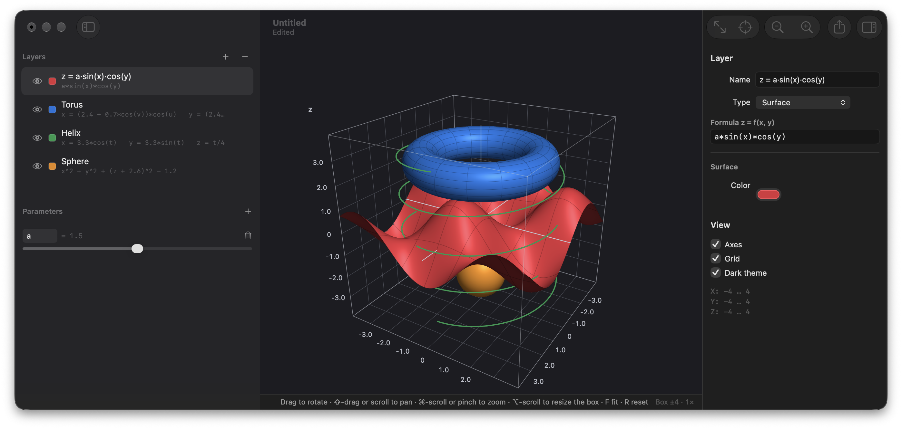

  

<h1 align="center">Grapher NG</h1>

  macOS 原生的数学绘图工具：输入公式，画出曲线、区域和曲面。 
  <a href="README.md">English</a> · <b>简体中文</b>

## 功能

- **平面图**：显函数 `y = f(x)`、参数方程、极坐标、隐函数 `F(x, y) = 0`、不等式区域。
- **立体图**：显式曲面、参数曲面、空间曲线、隐式曲面；平面曲线也能放进立体图。可自由旋转、平移、缩放。
- **参数滑块**：定义参数（如 `a`），在任意公式里当常量用，拖动滑块图形实时变化。
- **好写的公式**：支持隐式乘法（`2x`、`3sin(x)`）、常用数学函数与常量、`if(...)` 分段函数；写错时会指出出错的位置。
- **画质**：Metal 绘制，边缘清晰，任何缩放下线宽恒定。
- **读数**：鼠标移到平面曲线上，显示最近的点、坐标和斜率。
- **文件与导出**：存成 `.grapher` 文档；导出 PNG（1×/2×/4× 重新采样）、矢量 PDF、采样点 CSV。
- **访达集成**：文件图标就是图形缩略图，按空格可交互预览。
- **让 AI 帮你画**：内置 MCP 服务，Claude Code 等助手可以新建文档、插入曲线、区域和曲面，并查看结果。默认关闭，
  用法见 [docs/usage.zh-CN.md](docs/usage.zh-CN.md)。
- **语言**：中英双语，跟随系统语言。

## 下载

到 [GitHub Releases](https://github.com/xVanTuring/grapher-ng/releases) 下载 `GrapherNG-<版本>.dmg`，打开后把 Grapher NG
拖进「应用程序」。App 已用 Developer ID 签名并经过 Apple 公证，需要 macOS 14 或更高版本。
装好之后会每天自动检查一次更新，也可以在「Grapher NG ▸ 检查更新…」里手动检查。

## 快速上手

| 类型 | 示例 |
|---|---|
| 显函数 | `a*sin(x)/x` |
| 极坐标 | `1 + cos(theta)` |
| 隐函数 | `x^3 + y^3 - 3*x*y` |
| 不等式区域 | `x^2 + y^2 - 1` 配 `≤` |
| 立体图隐式曲面（球面） | `x^2 + y^2 + z^2 - 4` |

「文件 ▸ 加载示例」可以直接载入平面和立体的示例。常用操作：拖动平移（立体图里是旋转），`⌘` + 滚动或捏合缩放，
`F` 适应内容，`R` 重置视图，`⌘Z` / `⇧⌘Z` 撤销 / 重做，`⇧⌘N` 新建立体图。

## 开发

构建、代码结构、画质实现见 [DEV.zh-CN.md](DEV.zh-CN.md)；发布流程见 [docs/release.md](docs/release.md)。

## 许可协议

本项目以 [GNU 通用公共许可证 第 3 版或更新版本](LICENSE)（GPL-3.0-or-later）发布。
